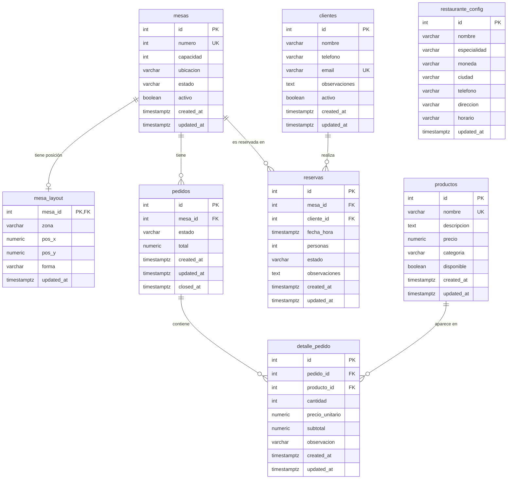

# Modelo entidad-relación y diccionario de datos

**Proyecto:** Trattoria Bellavista — Sistema de gestión de restaurante
**Motor:** PostgreSQL 16
**Historias de usuario:** HU-07 — Diseño del modelo entidad-relación (issue #3) y HU-09 — Persistencia de mesas, clientes y reservas (issue #9)
**Responsable:** Fernando
**Fuente:** `database/schema.sql`

---

## 1. Resumen del modelo

La base de datos tiene **8 tablas**:

| Tabla | Entidad del negocio | Descripción |
|---|---|---|
| `restaurante_config` | Restaurante | Datos generales del restaurante (nombre, moneda, horario…). |
| `mesas` | Mesas | Mesas físicas del restaurante, con su capacidad y estado. |
| `mesa_layout` | Layout | Posición, zona y forma de cada mesa en el plano interactivo. |
| `clientes` | Clientes | Personas que hacen reservas. |
| `reservas` | Reservas | Reserva de una mesa por un cliente en una fecha y hora. |
| `productos` | Productos | Platos y bebidas del menú. |
| `pedidos` | Pedidos | Pedido abierto en una mesa. |
| `detalle_pedido` | Detalles de pedido | Cada producto incluido en un pedido, con su cantidad y precio. |

**Convenciones:**

- **PK** = clave primaria (identificador único de cada fila).
- **FK** = clave foránea (columna que apunta a la clave primaria de otra tabla).
- **UQ** = valor único (no se puede repetir en la tabla).
- **NN** = obligatorio (no admite valores vacíos, `NOT NULL`).
- Todas las fechas usan `TIMESTAMPTZ` (fecha y hora con zona horaria).
- `created_at` se llena automáticamente al crear la fila. `updated_at` se actualiza al modificarla.

---

## 2. Diagrama entidad-relación

La imagen del diagrama está en `database/modelo-er.jpeg`.

El siguiente diagrama se genera a partir de este mismo texto y GitHub lo muestra como imagen:



`restaurante_config` no tiene relaciones con otras tablas.

---

## 3. Relaciones y cardinalidades

| Relación | Cardinalidad | Clave foránea | Al eliminar el registro padre | Regla del negocio |
|---|---|---|---|---|
| `mesas` → `mesa_layout` | 1 : 0..1 | `mesa_layout.mesa_id` | **CASCADE**: se borra también su posición | Cada mesa tiene como máximo una posición en el plano. |
| `mesas` → `pedidos` | 1 : N | `pedidos.mesa_id` | **RESTRICT**: no se puede borrar una mesa con pedidos | Una mesa acumula muchos pedidos a lo largo del tiempo. |
| `mesas` → `reservas` | 1 : N | `reservas.mesa_id` | **RESTRICT** | Una mesa puede reservarse muchas veces. |
| `clientes` → `reservas` | 1 : N | `reservas.cliente_id` | **RESTRICT**: no se puede borrar un cliente con reservas | Un cliente puede hacer muchas reservas. |
| `pedidos` → `detalle_pedido` | 1 : N | `detalle_pedido.pedido_id` | **CASCADE**: se borran también sus líneas | Un pedido contiene varias líneas. Puede estar vacío mientras está `ABIERTO`. |
| `productos` → `detalle_pedido` | 1 : N | `detalle_pedido.producto_id` | **RESTRICT**: no se puede borrar un producto ya vendido | Un producto puede aparecer en muchos pedidos. |

**Significado de las reglas de eliminación:**

- **CASCADE**: si se borra el registro principal, se borran automáticamente los registros que dependen de él.
- **RESTRICT**: PostgreSQL **impide** borrar el registro principal mientras existan registros que dependan de él. Así se protege el historial.

---

## 4. Diccionario de datos por tabla

### 4.1. `restaurante_config`

Configuración general del restaurante. Se espera **una sola fila**.

| Columna | Tipo | Restricciones | Valor por defecto | Descripción |
|---|---|---|---|---|
| `id` | INTEGER | PK | — | Identificador. |
| `nombre` | VARCHAR(150) | NN | `Trattoria Bellavista` | Nombre comercial. |
| `especialidad` | VARCHAR(120) | NN | `Cucina Italiana` | Tipo de cocina. |
| `moneda` | VARCHAR(10) | NN | `COP` | Moneda de los precios. |
| `ciudad` | VARCHAR(120) | — | — | Ciudad. |
| `telefono` | VARCHAR(40) | — | — | Teléfono de contacto. |
| `direccion` | VARCHAR(200) | — | — | Dirección física. |
| `horario` | VARCHAR(160) | — | — | Horario de atención en texto libre. |
| `updated_at` | TIMESTAMPTZ | NN | `now()` | Última modificación. |

### 4.2. `mesas`

| Columna | Tipo | Restricciones | Valor por defecto | Descripción |
|---|---|---|---|---|
| `id` | INTEGER | PK | — | Identificador interno. |
| `numero` | INTEGER | NN, UQ | — | Número visible de la mesa. No se repite. |
| `capacidad` | INTEGER | NN, `capacidad > 0` | — | Número máximo de personas. |
| `ubicacion` | VARCHAR(100) | — | — | Descripción libre de la ubicación. |
| `estado` | VARCHAR(30) | NN, valores permitidos (ver sección 5) | `LIBRE` | Estado operativo actual. |
| `activo` | BOOLEAN | NN | `true` | `false` = mesa desactivada (no se usa, pero se conserva su historial). |
| `created_at` | TIMESTAMPTZ | NN | `now()` | Fecha de creación. |
| `updated_at` | TIMESTAMPTZ | NN | `now()` | Última modificación. |

Restricciones con nombre: `ck_mesas_capacidad_positiva`, `ck_mesas_estado_valido`.

### 4.3. `mesa_layout`

Posición de cada mesa en el plano interactivo. Su clave primaria es también la clave foránea hacia `mesas`, lo que garantiza la relación 1 a 1.

| Columna | Tipo | Restricciones | Valor por defecto | Descripción |
|---|---|---|---|---|
| `mesa_id` | INTEGER | PK, FK → `mesas.id` (CASCADE) | — | Mesa a la que pertenece la posición. |
| `zona` | VARCHAR(30) | NN, `SALON`, `TERRAZA`, `VIP`, `BAR` u `OTRA` | `SALON` | Zona del plano. |
| `pos_x` | NUMERIC(5,2) | NN, entre 0 y 100 | — | Posición horizontal en porcentaje. |
| `pos_y` | NUMERIC(5,2) | NN, entre 0 y 100 | — | Posición vertical en porcentaje. |
| `forma` | VARCHAR(20) | NN, `ROUND`, `RECT` o `SMALL` | `ROUND` | Forma con la que se dibuja la mesa. |
| `updated_at` | TIMESTAMPTZ | NN | `now()` | Última modificación. |

Restricciones con nombre: `ck_mesa_layout_pos_x`, `ck_mesa_layout_pos_y`, `ck_mesa_layout_zona`, `ck_mesa_layout_forma`.

### 4.4. `clientes`

| Columna | Tipo | Restricciones | Valor por defecto | Descripción |
|---|---|---|---|---|
| `id` | INTEGER | PK | — | Identificador. |
| `nombre` | VARCHAR(150) | NN | — | Nombre completo. |
| `telefono` | VARCHAR(30) | — | — | Teléfono. |
| `email` | VARCHAR(150) | UQ | — | Correo. Opcional, pero si se registra no puede repetirse. |
| `observaciones` | TEXT | — | — | Notas (alergias, preferencias…). |
| `activo` | BOOLEAN | NN | `true` | `false` = cliente desactivado. Se puede reactivar. |
| `created_at` | TIMESTAMPTZ | NN | `now()` | Fecha de creación. |
| `updated_at` | TIMESTAMPTZ | NN | `now()` | Última modificación. |

### 4.5. `reservas`

| Columna | Tipo | Restricciones | Valor por defecto | Descripción |
|---|---|---|---|---|
| `id` | INTEGER | PK | — | Identificador. |
| `mesa_id` | INTEGER | NN, FK → `mesas.id` (RESTRICT) | — | Mesa reservada. |
| `cliente_id` | INTEGER | NN, FK → `clientes.id` (RESTRICT) | — | Cliente que reserva. |
| `fecha_hora` | TIMESTAMPTZ | NN | — | Fecha y hora de la reserva. |
| `personas` | INTEGER | NN, `personas > 0` | — | Número de comensales. |
| `estado` | VARCHAR(30) | NN, valores permitidos (ver sección 5) | `PENDIENTE` | Estado de la reserva. |
| `observaciones` | TEXT | — | — | Notas de la reserva. |
| `created_at` | TIMESTAMPTZ | NN | `now()` | Fecha de creación. |
| `updated_at` | TIMESTAMPTZ | NN | `now()` | Última modificación. |

Restricciones con nombre: `ck_reservas_personas_positivas`, `ck_reservas_estado_valido`.

Reglas agregadas en la HU-09:

- `ex_reservas_mesa_franja`: una mesa no puede tener dos reservas activas (`PENDIENTE`, `CONFIRMADA` o `EN_MESA`) con menos de 2 horas de diferencia. Es la misma ventana que usa el backend. Las reservas canceladas, completadas o en las que el cliente no asistió no bloquean la mesa.
- `tg_reservas_capacidad`: el número de personas no puede superar la capacidad de la mesa.
- `tg_mesas_capacidad` (en `mesas`): no se puede bajar la capacidad de una mesa por debajo de una reserva activa que ya tiene.
- `ix_reservas_mesa_fecha`: índice para buscar rápido las reservas activas de una mesa por fecha, que es la consulta de disponibilidad.

### 4.6. `productos`

| Columna | Tipo | Restricciones | Valor por defecto | Descripción |
|---|---|---|---|---|
| `id` | INTEGER | PK | — | Identificador. |
| `nombre` | VARCHAR(150) | NN, UQ | — | Nombre del producto. No se repite. |
| `descripcion` | TEXT | — | — | Descripción para el menú. |
| `precio` | NUMERIC(12,2) | NN, `precio > 0` | — | Precio de venta actual. |
| `categoria` | VARCHAR(30) | NN, `ENTRADA`, `PLATO_FUERTE`, `BEBIDA`, `POSTRE` u `OTRO` | `OTRO` | Categoría del menú. |
| `disponible` | BOOLEAN | NN | `true` | `false` = no se ofrece en nuevos pedidos. |
| `created_at` | TIMESTAMPTZ | NN | `now()` | Fecha de creación. |
| `updated_at` | TIMESTAMPTZ | NN | `now()` | Última modificación. |

Restricciones con nombre: `ck_productos_precio_positivo`, `ck_productos_categoria_valida`.

### 4.7. `pedidos`

| Columna | Tipo | Restricciones | Valor por defecto | Descripción |
|---|---|---|---|---|
| `id` | INTEGER | PK | — | Identificador. |
| `mesa_id` | INTEGER | NN, FK → `mesas.id` (RESTRICT) | — | Mesa donde se abrió el pedido. |
| `estado` | VARCHAR(30) | NN, valores permitidos (ver sección 5) | `ABIERTO` | Estado del pedido. |
| `total` | NUMERIC(12,2) | NN, `total >= 0` | `0.00` | Suma de los subtotales de sus líneas. |
| `created_at` | TIMESTAMPTZ | NN | `now()` | Apertura del pedido. |
| `updated_at` | TIMESTAMPTZ | NN | `now()` | Última modificación. |
| `closed_at` | TIMESTAMPTZ | — | — | Fecha de cierre. Vacío mientras el pedido sigue activo. |

Restricciones con nombre: `ck_pedidos_estado_valido`, `ck_pedidos_total_no_negativo`.

### 4.8. `detalle_pedido`

| Columna | Tipo | Restricciones | Valor por defecto | Descripción |
|---|---|---|---|---|
| `id` | INTEGER | PK | — | Identificador. |
| `pedido_id` | INTEGER | NN, FK → `pedidos.id` (CASCADE) | — | Pedido al que pertenece la línea. |
| `producto_id` | INTEGER | NN, FK → `productos.id` (RESTRICT) | — | Producto pedido. |
| `cantidad` | INTEGER | NN, `cantidad > 0` | — | Unidades pedidas. |
| `precio_unitario` | NUMERIC(12,2) | NN, `precio_unitario > 0` | — | Precio **en el momento del pedido**. Se guarda aparte para que un cambio de precio posterior no altere pedidos antiguos. |
| `subtotal` | NUMERIC(12,2) | NN, `subtotal > 0` | — | `cantidad × precio_unitario`. |
| `observacion` | VARCHAR(250) | — | — | Indicación especial (por ejemplo, «sin cebolla»). |
| `created_at` | TIMESTAMPTZ | NN | `now()` | Fecha de creación. |
| `updated_at` | TIMESTAMPTZ | NN | `now()` | Última modificación. |

Restricción única `uq_detalle_pedido_producto` sobre (`pedido_id`, `producto_id`): un producto aparece **una sola vez** por pedido. Para pedir más unidades se aumenta la `cantidad`.

Otras restricciones con nombre: `ck_detalle_pedido_cantidad_positiva`, `ck_detalle_pedido_precio_positivo`, `ck_detalle_pedido_subtotal_positivo`.

---

## 5. Estados controlados

PostgreSQL solo acepta los valores listados (restricciones `CHECK`). El **orden de las transiciones** lo controla el backend, no la base de datos.

### 5.1. Estado de `mesas`

| Estado | Significado |
|---|---|
| `LIBRE` | Disponible. Es el estado inicial. |
| `RESERVADA` | Tiene una reserva confirmada. |
| `OCUPADA` | Hay clientes sentados y un pedido activo. |
| `FUERA_DE_SERVICIO` | No disponible para atención. |

### 5.2. Estado de `reservas`

```
PENDIENTE → CONFIRMADA → EN_MESA → COMPLETADA
     ↘           ↘
   CANCELADA   CANCELADA / NO_ASISTIO
```

| Estado | Significado |
|---|---|
| `PENDIENTE` | Recién creada. Estado inicial. |
| `CONFIRMADA` | Aceptada. La mesa pasa a `RESERVADA`. |
| `EN_MESA` | El cliente llegó y se sentó. Se abre un pedido y la mesa pasa a `OCUPADA`. |
| `COMPLETADA` | Atención terminada. |
| `CANCELADA` | Anulada antes de la atención. |
| `NO_ASISTIO` | El cliente no se presentó. |

### 5.3. Estado de `pedidos`

```
ABIERTO → EN_PREPARACION → LISTO → ENTREGADO → PAGADO
(CANCELADO cuando corresponde)
```

| Estado | Significado |
|---|---|
| `ABIERTO` | Se están agregando productos. Estado inicial. |
| `EN_PREPARACION` | Enviado a cocina. No se permite enviar un pedido sin productos. |
| `LISTO` | Cocina terminó la preparación. |
| `ENTREGADO` | Servido en la mesa. |
| `PAGADO` | Cerrado y cobrado. |
| `CANCELADO` | Anulado. |

---

## 6. Decisiones de eliminación y desactivación

Para no perder el historial de ventas y reservas, la regla es **desactivar en vez de borrar**.

El backend actual (HU-14 y HU-15) no tiene endpoints para borrar mesas, clientes, productos ni reservas. Así se retira cada cosa:

| Tabla | Cómo se retira un registro | Por qué |
|---|---|---|
| `clientes` | `activo = false`. Se puede reactivar. | El backend no deja reservar a un cliente inactivo. Sus reservas anteriores se conservan. |
| `mesas` | `activo = false` o estado `FUERA_DE_SERVICIO`. | El backend no deja reservar una mesa en ninguno de los dos casos. |
| `productos` | `disponible = false`. | Deja de ofrecerse sin afectar los pedidos anteriores. |
| `reservas` | Estado `CANCELADA` o `NO_ASISTIO`. | Conserva el historial y libera la mesa para esa franja. |
| `pedidos` | Estado `CANCELADO`. | Conserva el historial. |

Si aun así alguien intenta borrar desde la base de datos, las claves foráneas lo controlan:

- **RESTRICT:** no se puede borrar una mesa con pedidos o reservas, un cliente con reservas, ni un producto que ya se vendió.
- **CASCADE:** si se borra una mesa sin historial, se borra su posición en el plano; si se borra un pedido, se borran sus líneas.

Los cambios de estado (por ejemplo, que una reserva solo pase de `PENDIENTE` a `CONFIRMADA` o `CANCELADA`) los controla el backend. La base de datos solo garantiza que el estado sea uno de los valores permitidos.

---

## 7. Observaciones

Reglas que ya se resolvieron en la base de datos:

- **Doble reserva** (HU-09): la restricción `ex_reservas_mesa_franja` impide dos reservas activas de la misma mesa a menos de 2 horas.
- **Capacidad** (HU-09): los triggers `tg_reservas_capacidad` y `tg_mesas_capacidad` impiden reservar más personas de las que caben.

Reglas que todavía dependen del backend:

1. **Totales:** que `subtotal = cantidad × precio_unitario` y que `pedidos.total` sea la suma de los subtotales lo calcula el backend. Se revisará en la HU-10.
2. **Configuración única:** nada impide insertar más de una fila en `restaurante_config`.
3. **`updated_at`:** el backend lo actualiza al modificar una fila. Un `UPDATE` hecho directamente en SQL no lo cambia, porque no hay trigger.
4. **Reserva y pedido:** no hay una clave foránea que relacione la reserva con el pedido que se abre al sentar al cliente.
5. **Mesa o cliente inactivos:** que no se pueda reservar con una mesa o un cliente inactivo lo valida el backend.

Al aplicar `schema.sql` sobre una base que ya tiene datos, la restricción de doble reserva no se crea si ya existen reservas activas que se cruzan. En ese caso el script falla y no cambia nada; hay que cancelar o mover esas reservas y volver a ejecutarlo.
