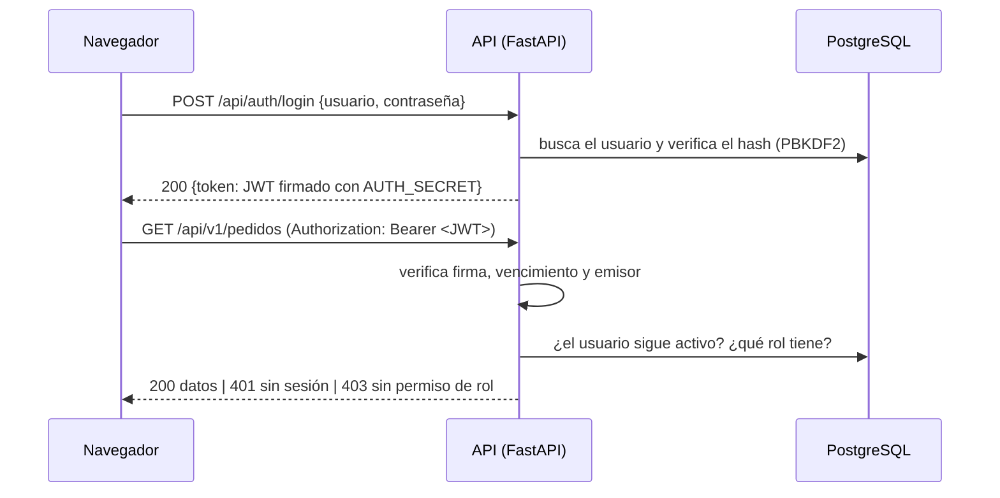

# Autenticación y autorización

Mecanismo elegido: **JWT (JSON Web Tokens)**, de las opciones del enunciado. Por encima de la autenticación hay control de acceso por **rol** y varios controles contra abuso (límite de intentos, bloqueo de cuenta, auditoría).

## 1. Cómo funciona



- **Contraseñas:** se guardan con PBKDF2-HMAC-SHA256 (310 000 iteraciones y sal aleatoria). Nunca en texto plano.
- **Token:** JWT estándar (RFC 7519) firmado con HS256. Se puede pegar en [jwt.io](https://jwt.io) para ver su contenido. Claims: `sub` (id del usuario), `rol`, `iss`, `iat`, `exp` (8 horas) y `jti` (identificador único).
- **Verificación:** se fija el algoritmo (HS256), así que un token con `alg: none` u otro algoritmo se rechaza. Se exigen `exp`, `sub` e `iss`. Implementación en `backend/app/core/security.py` con la librería PyJWT.
- **El rol y el estado no se toman del token:** en cada petición se consulta la base (`app/core/dependencies.py`). Un usuario desactivado pierde el acceso al instante aunque su token siga vigente, y un token que afirme ser ADMIN no sirve si la base dice PERSONAL.
- **Otras formas de ingreso:** reconocimiento facial con reto de un solo uso (`docs/ia.md`) y solicitud de cuenta aprobada por un administrador. Ambas terminan emitiendo el mismo JWT.

## 2. Qué está protegido

El enunciado exige proteger al menos crear, actualizar y eliminar. Aquí **toda** la API de negocio exige sesión, también la lectura.

| Rutas | Requisito |
|---|---|
| `/api/v1/*` (mesas, productos, clientes, reservas, pedidos, cocina, reportes, configuración, voz) | JWT válido |
| `/api/usuarios/*`, `/api/solicitudes/*` | JWT de un **administrador** |
| `POST /api/v1/productos`, `PATCH /api/v1/productos/{id}`, `POST /api/v1/mesas`, `PUT /api/v1/mesas/{id}/layout`, `PATCH /api/v1/configuracion` | JWT de un **administrador** |
| `POST /api/auth/login`, `/face-challenge`, `/face-login`, `/registro` | Públicas (son la puerta de entrada; con límite de intentos) |
| `POST /api/ubicaciones/lecturas` | Cabecera `X-Gateway-Token` (gateways BLE) |
| `POST /api/v1/voz/audio` | Cabecera `X-Device-Key` (terminal ESP32) |
| `GET /health`, `GET /health/db`, `GET /metrics` | Públicas (sondas de Kubernetes y Prometheus) |

La prueba `backend/tests/test_autenticacion.py::test_toda_ruta_exige_sesion_salvo_las_publicas_conocidas` recorre el OpenAPI y **falla si alguien agrega una ruta sin protección** que no esté en esa lista.

### Roles

| Rol | Puede |
|---|---|
| `ADMIN` | Todo: usuarios, solicitudes de acceso, productos, configuración, creación de mesas y plano |
| `PERSONAL` | Operar: pedidos, cocina, reservas, clientes, cambiar el estado de las mesas y pedir por voz |

## 3. Secretos y Kubernetes

Ninguna llave está en el código ni en los manifiestos. Todo viene del entorno:

| Variable | Para qué | Dónde se define |
|---|---|---|
| `AUTH_SECRET` | Firma de los JWT | Docker: `.env`. Kubernetes: `Secret trattoria-secret` (`k8s/secret.example.yaml`) |
| `GATEWAY_TOKEN` | Gateways BLE | igual |
| `VOZ_DEVICE_KEY` | Terminal ESP32 | igual |
| `GEMINI_API_KEY` | Modelo de lenguaje | igual |

- `k8s/secret.yaml` está en `.gitignore`; solo se versiona la plantilla `secret.example.yaml`.
- Con `ENVIRONMENT=production` (Docker Compose y Kubernetes), **el backend no arranca** si falta `AUTH_SECRET`, si tiene menos de 32 caracteres o si sigue con el valor de ejemplo. Así no hay réplicas firmando con llaves distintas, que haría fallar las sesiones al azar (el Deployment tiene 2 réplicas).
- Generar una llave: `python -c "import secrets; print(secrets.token_urlsafe(48))"`.

## 4. Demostración (para la sustentación)

Sustituye `localhost` por el host del clúster si corresponde (`-k` acepta el certificado local).

```bash
# 1. Sin token: rechazado
curl -sk -i https://localhost/api/v1/productos | head -1                  # HTTP/2 401

# 2. Ingreso: devuelve el JWT
TOKEN=$(curl -sk -X POST https://localhost/api/auth/login \
  -H 'Content-Type: application/json' \
  -d '{"username":"admin","password":"<contraseña>"}' | python -c "import sys,json;print(json.load(sys.stdin)['token'])")
echo $TOKEN | cut -d. -f2 | base64 -d 2>/dev/null; echo                   # payload: sub, rol, iss, iat, exp, jti

# 3. Con token: permitido
curl -sk -H "Authorization: Bearer $TOKEN" https://localhost/api/v1/productos | head -c 200

# 4. Token alterado: rechazado
curl -sk -o /dev/null -w "%{http_code}\n" -H "Authorization: Bearer ${TOKEN}x" https://localhost/api/v1/productos   # 401

# 5. Un usuario PERSONAL no puede crear productos (403); el ADMIN sí
curl -sk -X POST https://localhost/api/v1/productos -H "Authorization: Bearer $TOKEN_PERSONAL" \
  -H 'Content-Type: application/json' -d '{"nombre":"Prueba","precio":1000,"categoria":"ENTRADA"}'
```

También se puede mostrar en Swagger (`/docs`): botón **Authorize**, pegar el token y probar los endpoints.

Pruebas automáticas: `cd backend && pytest tests/test_autenticacion.py tests/test_auth.py tests/test_ingreso_facial.py tests/test_solicitudes.py -v`.

## 5. Controles contra abuso

- **Límite de intentos:** 10 fallos cada 10 minutos por IP en el ingreso con contraseña y en el facial; 5 solicitudes de cuenta por hora por IP.
- **Bloqueo de cuenta:** 5 fallos seguidos bloquean la cuenta 15 minutos (también en el ingreso facial 1:1).
- **Tiempo de respuesta constante** con usuarios inexistentes (se verifica un hash ficticio) para no revelar qué usuarios existen.
- **Auditoría:** cada intento queda en `auditoria_accesos` (método, resultado, motivo, IP).

## 6. Limitaciones conocidas

- **No hay cierre de sesión en el servidor.** El token es sin estado y vale 8 horas; "Cerrar sesión" lo borra del navegador (`sessionStorage`), pero un token copiado seguiría válido hasta vencer. Mitigación actual: desactivar al usuario lo invalida al instante. Mejora posible: lista de `jti` revocados o tokens de vida corta con refresco.
- **El token vive en `sessionStorage`**, accesible desde JavaScript. Una cookie `HttpOnly` reduce el riesgo de robo por XSS, a cambio de proteger también contra CSRF.
- **Los límites de intentos están en memoria de cada pod.** Con 2 réplicas el límite efectivo se duplica. Mover el contador a Redis o a la base lo haría compartido.
- La llave `AUTH_SECRET` es simétrica: quien la tenga puede emitir tokens. Rotarla invalida todas las sesiones.
- El tráfico solo es seguro si va por HTTPS (en el despliegue lo termina Caddy/Ingress).
