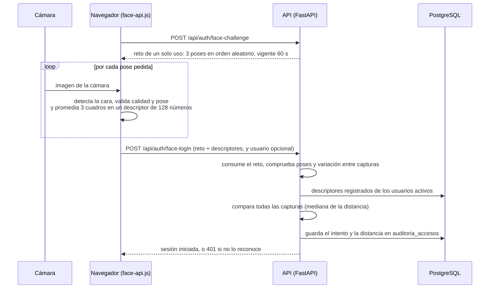
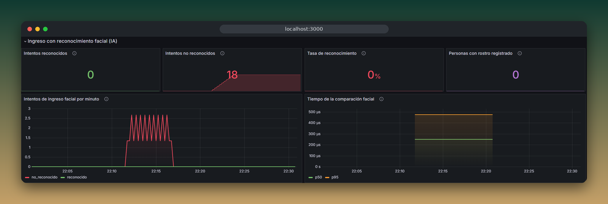

# Ingreso con reconocimiento facial

Este documento explica la parte de inteligencia artificial de Trattoria Bellavista: el ingreso del personal con la cámara. La funcionalidad la construyó Keiner (HU-23) y la medición en Prometheus y Grafana es parte de la HU-21.

## El problema

En el restaurante varias personas usan el mismo computador durante el turno: meseros, cocina y administración. Escribir usuario y contraseña cada vez es lento y lleva a malas prácticas, como dejar la sesión abierta o anotar la clave en un papel junto a la pantalla. Queríamos que cada persona pudiera entrar mirando a la cámara, que quedara registrado quién entró y cuándo, y que el usuario y la contraseña siguieran funcionando como respaldo.

## Cómo funciona



1. **Registro.** Un administrador abre *Usuarios y acceso* y registra el rostro de cada empleado. El asistente pide cinco posiciones (de frente, izquierda, derecha, arriba y abajo) y exige al menos tres. Cada posición se captura a la distancia correcta y es el promedio de 4 cuadros. Se guardan en la tabla `rostro_plantillas` con `PUT /api/usuarios/{id}/rostro`. El servidor rechaza el registro si las posiciones no parecen ser de la misma persona o si ese rostro ya está registrado a otro usuario.
2. **Guía de calidad.** Antes de usar un cuadro, el navegador comprueba que el detector esté seguro, que el rostro esté centrado y a buena distancia (ni lejos ni demasiado cerca) y que tenga la pose pedida. Si no, le dice a la persona qué corregir. La cámara pide 1280×720 para que a distancia el rostro conserve detalle.
3. **Reto.** Al abrir el ingreso, el servidor entrega un reto de un solo uso: las poses de frente, izquierda y derecha en orden aleatorio. Vence a los 60 s, está ligado a la IP y no puede reutilizarse. La persona hace cada pose; el navegador envía todas las capturas juntas.
4. **Verificación en el servidor.** La API comprueba que las capturas sean exactamente las del reto, en ese orden, y que no sean casi idénticas entre sí (una foto fija o un vector repetido produce descriptores iguales). Para cada persona usa la **mediana** de la distancia de sus capturas a su plantilla más cercana, y solo la acepta si:
   - la mediana es de **0,55 o menos** (`FACE_UMBRAL`; face-api.js propone 0,6), y ninguna captura se aleja más de 0,10 de ese umbral, y
   - la segunda persona más cercana está al menos **0,05** más lejos. Si dos personas quedan casi igual de cerca, no deja entrar a ninguna.
5. **Ingreso 1:1 (recomendado).** Si la persona escribe su usuario, solo se compara contra su propio rostro (umbral `FACE_UMBRAL_1A1`, 0,60) y los fallos cuentan para el bloqueo de la cuenta (5 fallos, 15 minutos), igual que con la contraseña.
6. **Auditoría.** Cada intento queda en `auditoria_accesos` con su motivo y la distancia medida (`OK d=0.41`, `ROSTRO_NO_RECONOCIDO d=0.71`). Sirve para calibrar los umbrales con datos reales.

Límites honestos: la pose y el parpadeo se calculan en el navegador, así que quien tenga acceso directo a la API y los descriptores de la víctima en tres poses podría enviarlos. El reto y la comprobación de variación suben mucho el costo del ataque, pero no reemplazan una detección de ataques de presentación hecha en el servidor. Los descriptores se guardan sin cifrar en `rostro_plantillas`.

El código está en `frontend-react/src/services/faceApi.js` (navegador) y en `backend/app/services/auth_service.py` (comparación).

## El modelo y por qué lo escogimos

Usamos [`@vladmandic/face-api`](https://github.com/vladmandic/face-api), una versión mantenida de face-api.js que corre sobre TensorFlow.js. No entrenamos ningún modelo: usamos tres redes que ya vienen entrenadas.

| Red | Para qué | Origen según su documentación |
|---|---|---|
| SSD MobileNet v1 | Encontrar la cara en la imagen (confianza mínima 0,5) | Entrenada con el dataset WIDER FACE |
| Face Landmark 68 | Ubicar 68 puntos de la cara (ojos, nariz, boca, mentón) | Preentrenada en face-api.js |
| Face Recognition | Convertir la cara en un descriptor de 128 números | Arquitectura parecida a ResNet-34, equivalente al modelo de reconocimiento de dlib; sus autores reportan 99,38 % de acierto en el benchmark LFW |

Las razones:

- **No tenemos datos para entrenar.** Un modelo propio necesitaría miles de fotos etiquetadas de muchas personas. Con redes preentrenadas basta con registrar unas pocas posiciones de cada empleado.
- **Corre en el navegador.** No hace falta un servidor con GPU ni un servicio pagado. El análisis lo hace el computador del restaurante, y a la API solo llega un arreglo de números.
- **Privacidad.** Como solo viaja el descriptor, en la base no hay fotos de nadie.
- **Funciona sin internet.** Los modelos (unos 12 MB) van dentro de la imagen del frontend, en `frontend-react/public/models`.

Escogimos SSD MobileNet v1 y no Tiny Face Detector, que también está en la carpeta, porque es más preciso y en un computador de escritorio la diferencia de velocidad no se nota.

## Los datos

No usamos un dataset propio. Los datos son los de la aplicación:

| Tabla | Qué guarda |
|---|---|
| `usuarios` | Cada empleado, su rol (ADMIN o PERSONAL) y si está activo. Solo se comparan los rostros de usuarios activos |
| `rostro_plantillas` | Un descriptor de 128 números por cada posición registrada (`FRENTE`, `IZQUIERDA`, `DERECHA`, `ARRIBA`, `ABAJO`). Si se borra el usuario, se borran sus descriptores |
| `auditoria_accesos` | Cada intento de ingreso: método (`ROSTRO` o `PASSWORD`), si fue exitoso, el motivo (`OK`, `ROSTRO_NO_RECONOCIDO`, `CREDENCIALES_INVALIDAS`, `CUENTA_BLOQUEADA`), la IP y la hora |

## Cómo lo evaluamos

**Pruebas automáticas.** En `backend/tests/test_auth.py` hay pruebas de la lógica de comparación: acepta un rostro cercano, rechaza uno lejano, rechaza cuando dos personas quedan casi igual de cerca, no acepta a nadie si no hay rostros registrados, escoge la posición más parecida de cada persona y exige posiciones distintas y un mínimo de tres. Corren junto con las demás pruebas del backend (48 en total).

**Métricas en Prometheus y Grafana (HU-21).** La API publica en `/metrics`:

| Métrica | Qué mide |
|---|---|
| `trattoria_ingreso_facial_total{resultado="reconocido"}` | Ingresos faciales en los que se encontró a la persona |
| `trattoria_ingreso_facial_total{resultado="no_reconocido"}` | Ingresos rechazados por distancia o por ambigüedad |
| `trattoria_ingreso_facial_comparacion_seconds` | Tiempo que tarda la comparación en la API (histograma) |
| `trattoria_personas_con_rostro` | Usuarios que tienen el rostro registrado (activos o no) |

El dashboard de Grafana tiene una sección dedicada con los intentos por resultado, la tasa de reconocimiento (reconocidos sobre el total), los intentos por minuto, el tiempo de la comparación y las personas con rostro registrado. Cómo desplegarlo está en [`k8s/monitoreo/README.md`](../k8s/monitoreo/README.md).



**Lo que medimos hasta ahora.** Durante las pruebas de tráfico mandamos 18 intentos con descriptores inventados al azar. Los 18 salieron como no reconocidos, o sea que ninguna "cara" inventada logró entrar, y la comparación tardó menos de medio milisegundo en todos los casos.

**Desde la base de datos.** La misma información queda en la auditoría, así que la tasa también se puede sacar con SQL:

```sql
SELECT metodo,
       count(*) AS intentos,
       count(*) FILTER (WHERE exitoso) AS exitosos,
       round(100.0 * count(*) FILTER (WHERE exitoso) / count(*), 1) AS tasa_exito
FROM auditoria_accesos
WHERE created_at >= now() - interval '7 days'
GROUP BY metodo
ORDER BY metodo;
```

**Lo que falta medir.** Todavía no hemos hecho una prueba formal con las personas del equipo frente a la cámara, porque no todos los computadores tienen una. La idea es esta: cada integrante registra su rostro y hace 10 intentos con luz normal, 5 con poca luz y 5 con gafas o tapabocas; anotamos cuántos fueron reconocidos (aciertos), cuántos no (falsos rechazos) y si alguno entró con la cuenta de otra persona (falsos aceptados). Ese último número es el más importante y debería ser cero.

## Limitaciones

- **Fotos y videos.** El sistema compara caras, no comprueba que haya una persona real frente a la cámara, así que una foto en el celular podría servir para entrar. El componente de la cámara ya trae una prueba de parpadeo (`requiereParpadeo` en `CamaraFacial.jsx`), pero la pantalla de ingreso todavía no la activa.
- **Luz, ángulo y accesorios.** Con poca luz, contraluz, gafas oscuras o tapabocas la detección falla más. Registrar varias posiciones ayuda, pero no lo resuelve del todo.
- **Umbrales sin calibrar.** El 0,55 y el 0,05 salen de la recomendación de face-api.js y de pruebas pequeñas, no de una medición con datos reales del restaurante.
- **Sesgos del modelo.** Las redes se entrenaron con fotos públicas que no sabemos qué tan bien representan a la población colombiana. El 99,38 % de LFW es el resultado que reportan los autores en ese benchmark, no algo que hayamos medido nosotros.
- **Límite de intentos por réplica.** La API acepta 10 intentos faciales fallidos cada 10 minutos por dirección, pero ese conteo vive en la memoria de cada pod. Con 2 réplicas en Kubernetes, en la práctica pueden ser hasta 20.
- **Datos personales.** En Colombia los datos biométricos son datos sensibles según la Ley 1581 de 2012. Antes de registrar el rostro de un empleado hay que pedirle autorización por escrito, explicarle para qué se usa y borrar sus descriptores si la retira o deja de trabajar en el restaurante (el administrador puede hacerlo con `DELETE /api/usuarios/{id}/rostro`).
- **Precisión de la métrica de tiempo.** El histograma de la comparación empieza en 0,5 ms. Con pocos rostros registrados todas las comparaciones caen ahí, y Grafana muestra valores interpolados (250 µs y 475 µs); el tiempo real es menor.

## Mejoras posibles

1. Activar la prueba de parpadeo en la pantalla de ingreso: es pasar `requiereParpadeo` al componente `CamaraFacial` en `LoginPage.jsx`.
2. Hacer la prueba con el equipo descrita arriba y ajustar los umbrales con esos resultados.
3. Llevar el límite de intentos a Redis o a PostgreSQL para que sea uno solo entre todas las réplicas.
4. Agregar al dashboard una alerta cuando los intentos no reconocidos suban de golpe, que puede ser señal de que alguien está probando con fotos.
