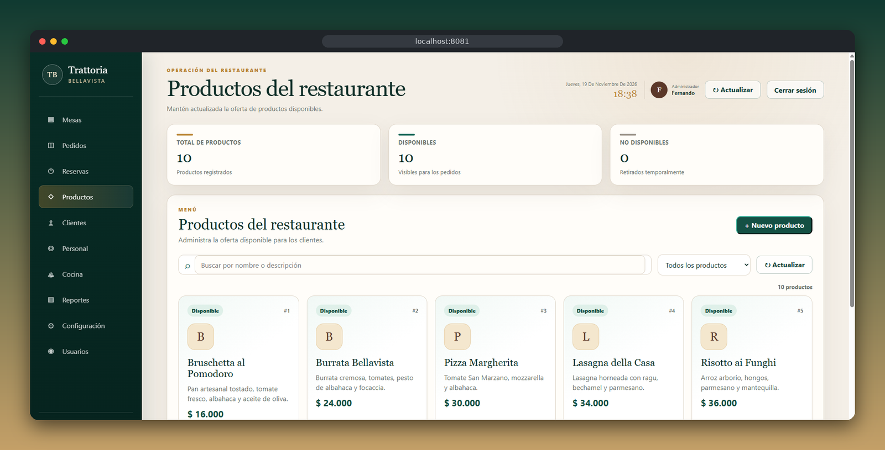
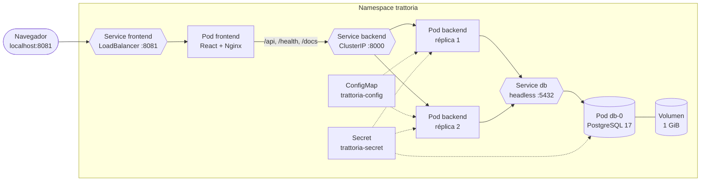
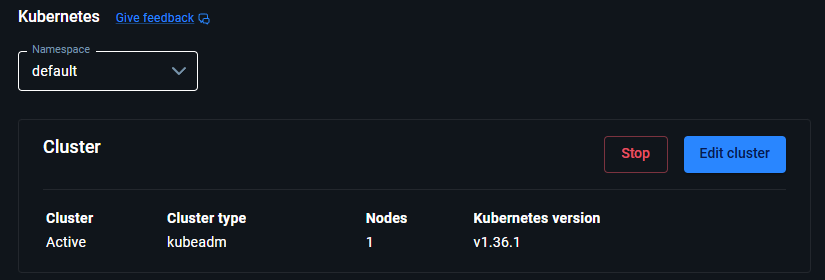
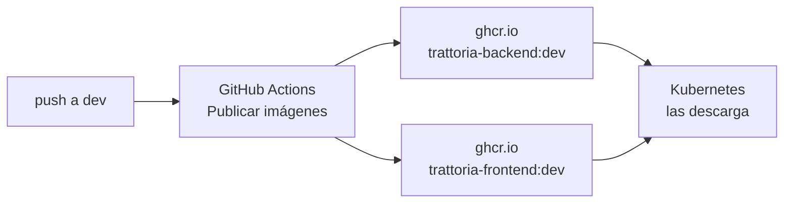
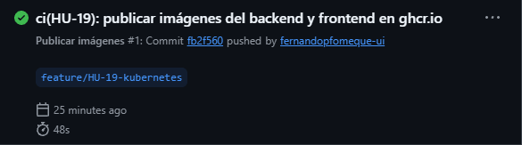
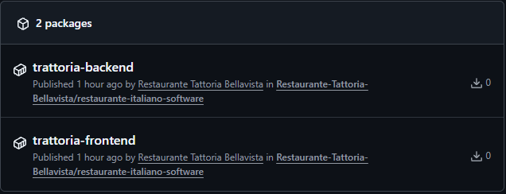
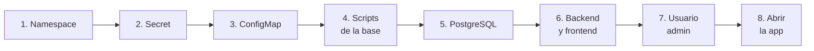
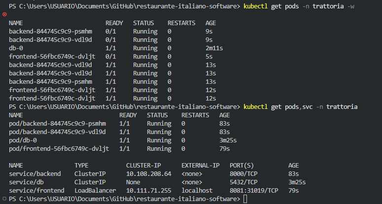
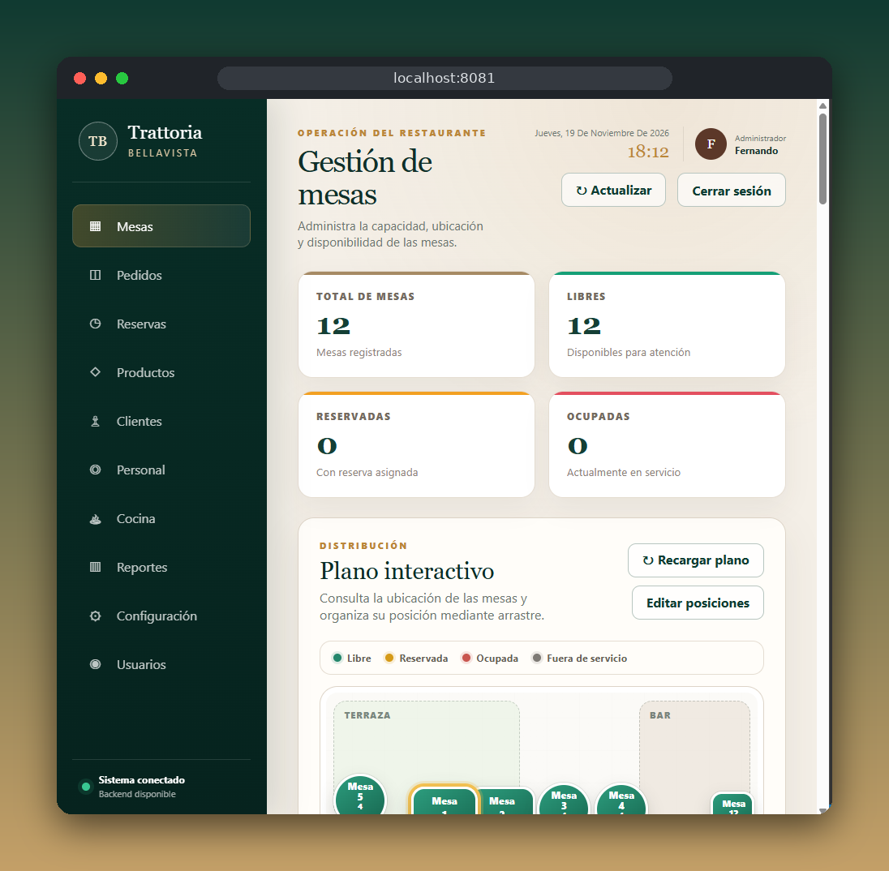

# Trattoria Bellavista en Kubernetes

Esta carpeta tiene todo lo necesario para correr la aplicación en un clúster de Kubernetes: la base de datos, la API y el frontend. Lo montamos y probamos con el Kubernetes que trae Docker Desktop (clúster **kubeadm** de un nodo, Kubernetes **v1.36.1**).



## Contenido

- [Cómo está armado](#cómo-está-armado)
- [Qué hay en la carpeta](#qué-hay-en-la-carpeta)
- [Requisitos](#requisitos)
- [Imágenes](#imágenes)
- [Desplegar paso a paso](#desplegar-paso-a-paso)
- [Prueba: Kubernetes se recupera solo](#prueba-kubernetes-se-recupera-solo)
- [Comandos del día a día](#comandos-del-día-a-día)
- [Decisiones y limitaciones](#decisiones-y-limitaciones)

## Cómo está armado



Las flechas punteadas son la configuración que reciben los pods: lo que no es secreto sale del ConfigMap y las claves salen del Secret.

Dos nombres no se pueden cambiar:

- El Service del backend tiene que llamarse **`backend`**, porque así lo busca el Nginx del frontend (`frontend-react/nginx.conf`).
- El Service de la base tiene que llamarse **`db`**, porque así aparece en la `DATABASE_URL` que usa el backend.

## Qué hay en la carpeta

| Archivo | Qué crea | Detalles |
|---|---|---|
| `00-namespace.yaml` | Namespace `trattoria` | Todo lo de la app queda separado del resto del clúster |
| `01-configmap.yaml` | ConfigMap `trattoria-config` | Nombre de la base, usuario, ambiente y duración de la sesión |
| `secret.example.yaml` | Plantilla del Secret | Solo trae valores `CAMBIAR_...`; el Secret real va en `secret.yaml` |
| `02-postgres.yaml` | StatefulSet + Service `db` | PostgreSQL 17 con volumen persistente de 1 GiB |
| `03-backend.yaml` | Deployment + Service `backend` | FastAPI con **2 réplicas**, probes y límites de recursos |
| `04-frontend.yaml` | Deployment + Service `frontend` | React con Nginx, publicado en el puerto **8081** |

Recursos que pide cada parte:

| Contenedor | Réplicas | CPU (request / limit) | Memoria (request / limit) | Readiness | Liveness |
|---|:---:|---|---|---|---|
| backend | 2 | 100m / 500m | 128Mi / 384Mi | `GET /health/db` | `GET /health` |
| frontend | 1 | 50m / 250m | 32Mi / 128Mi | `GET /` | `GET /` |
| postgres | 1 | 100m / 500m | 256Mi / 512Mi | `pg_isready` | `pg_isready` |

## Requisitos

**Docker Desktop con Kubernetes activado.** En Docker Desktop: menú **Kubernetes** > **Create cluster** > **Kubeadm** > **Create**. Cuando termine, el clúster debe aparecer como *Active*:



**kubectl.** Viene incluido con Docker Desktop. Antes de aplicar cualquier cosa conviene revisar que esté apuntando al clúster correcto:

```powershell
kubectl config current-context
kubectl get nodes
```

El contexto debe ser `docker-desktop` y el nodo debe estar en `Ready`.

> [!NOTE]
> Todos los comandos se corren desde la raíz del repositorio. Están en PowerShell porque trabajamos en Windows.

## Imágenes

Las imágenes las construye y las publica el workflow [`.github/workflows/imagenes.yml`](../.github/workflows/imagenes.yml) cada vez que entra un cambio del backend o del frontend a `dev`.





| Imagen | Etiquetas |
|---|---|
| `ghcr.io/restaurante-tattoria-bellavista/trattoria-backend` | `dev` y `sha-<commit>` |
| `ghcr.io/restaurante-tattoria-bellavista/trattoria-frontend` | `dev` y `sha-<commit>` |

La etiqueta `sha-<commit>` sirve para volver a una versión anterior si algo sale mal.



Los paquetes son públicos, así que el clúster los descarga sin credenciales y no hace falta un `imagePullSecret`. El workflow usa el `GITHUB_TOKEN` que GitHub crea en cada ejecución: no hay ningún token personal guardado en el repositorio.

<details>
<summary><b>Probar con imágenes construidas en el propio computador</b></summary>

<br>

Si se quiere probar algo que todavía no está en `dev`, se pueden construir las imágenes con el mismo nombre. Los Deployments usan `imagePullPolicy: IfNotPresent`, así que el Kubernetes de Docker Desktop usa la imagen local si ya existe:

```powershell
docker build -t ghcr.io/restaurante-tattoria-bellavista/trattoria-backend:dev ./backend
docker build -t ghcr.io/restaurante-tattoria-bellavista/trattoria-frontend:dev ./frontend-react
```

</details>

## Desplegar paso a paso



> [!WARNING]
> Los archivos se aplican uno por uno y en este orden. No usar `kubectl apply -f k8s/` sobre toda la carpeta: también aplicaría `secret.example.yaml` y dejaría el Secret con los valores de la plantilla.

### 1. Namespace

```powershell
kubectl apply -f k8s/00-namespace.yaml
```

### 2. Secret con las claves

Copiar la plantilla y generar tres valores al azar:

```powershell
Copy-Item k8s/secret.example.yaml k8s/secret.yaml
1..3 | ForEach-Object { [guid]::NewGuid().ToString("N") }
```

En `k8s/secret.yaml`, cambiar `CAMBIAR_PASSWORD`, `CAMBIAR_AUTH_SECRET` y `CAMBIAR_GATEWAY_TOKEN` por esos valores, en ese orden. Después:

```powershell
kubectl apply -f k8s/secret.yaml
```

> [!CAUTION]
> `k8s/secret.yaml` está en `.gitignore` y **nunca** se sube al repositorio. Antes de hacer commit, revisar que no aparezca entre los cambios.

### 3. Configuración

```powershell
kubectl apply -f k8s/01-configmap.yaml
```

### 4. Scripts de la base

La base se inicializa con `database/schema.sql` y `database/seed.sql`. En vez de copiar el esquema dentro de `k8s/`, el ConfigMap se crea directamente desde esos archivos, así hay una sola versión del esquema:

```powershell
kubectl create configmap postgres-init -n trattoria --from-file=01-schema.sql=database/schema.sql --from-file=02-seed.sql=database/seed.sql
```

### 5. PostgreSQL

```powershell
kubectl apply -f k8s/02-postgres.yaml
kubectl get pods -n trattoria -w
```

Esperar a que `db-0` quede en `1/1 Running` y salir con `Ctrl + C`. Para confirmar que los scripts corrieron:

```powershell
kubectl exec -n trattoria db-0 -- psql -U restaurant -d restaurant -c "select (select count(*) from mesas) as mesas, (select count(*) from productos) as productos, (select count(*) from pg_trigger where not tgisinternal) as triggers;"
```

Resultado esperado:

```
 mesas | productos | triggers
-------+-----------+----------
    12 |        10 |        5
```

### 6. Backend y frontend

El backend va primero, porque el Nginx del frontend necesita que el Service `backend` exista cuando arranca.

```powershell
kubectl apply -f k8s/03-backend.yaml
kubectl apply -f k8s/04-frontend.yaml
kubectl get pods,svc -n trattoria
```



En la captura se ve cómo arrancan los pods: primero aparecen en `0/1` y pasan a `1/1` cuando su readiness probe confirma que están listos. En el caso del backend, eso significa que ya tienen conexión con la base.

### 7. Usuario administrador

La base arranca sin usuarios. El backend trae un script para crear el primero; la contraseña se pide en la terminal y no se muestra mientras se escribe:

```powershell
kubectl exec -n trattoria -it deploy/backend -- env ADMIN_USERNAME=admin ADMIN_NOMBRE=Administrador python -m app.scripts.crear_admin
```

### 8. Abrir la app

**<http://localhost:8081>**

Después de iniciar sesión, la pantalla de mesas debe mostrar las 12 mesas del `seed.sql`:

<p align="center"></p>

En Docker Desktop, un Service tipo LoadBalancer queda publicado en `localhost`. En otros clústeres locales, como minikube o kind, se puede entrar con un port-forward:

```powershell
kubectl port-forward -n trattoria svc/frontend 8081:8081
```

> [!TIP]
> Entramos por `localhost` a propósito: los navegadores solo dejan usar la cámara (para el ingreso facial) en páginas con HTTPS o en `localhost`. Así no hace falta montar certificados dentro del clúster.

## Prueba: Kubernetes se recupera solo

Con esta prueba se ven varias cosas a la vez:

| Lo que pasa | Qué lo explica |
|---|---|
| Al borrar un pod del backend, aparece otro en segundos | El Deployment pide 2 réplicas y Kubernetes las mantiene |
| El pod nuevo empieza en `0/1` y luego pasa a `1/1` | La readiness probe no le manda tráfico hasta que tiene conexión con la base |
| La app sigue funcionando todo el tiempo | La otra réplica atiende mientras tanto |
| La sesión no se cierra al recargar | Las dos réplicas firman los tokens con la misma `AUTH_SECRET`, que sale del Secret |

Con la app abierta y la sesión iniciada, borrar una réplica:

```powershell
kubectl delete pod -n trattoria (kubectl get pods -n trattoria -l app=backend -o jsonpath="{.items[0].metadata.name}")
```

Ver cómo aparece la nueva (salir con `Ctrl + C` cuando esté en `1/1`):

```powershell
kubectl get pods -n trattoria -l app=backend -w
```

Al recargar la página varias veces, la sesión se mantiene.

## Comandos del día a día

| Para qué | Comando |
|---|---|
| Ver todo lo que está corriendo | `kubectl get pods,svc -n trattoria` |
| Ver los logs de la API | `kubectl logs -n trattoria deploy/backend` |
| Revisar por qué un pod no arranca | `kubectl describe pod -n trattoria db-0` |
| Reiniciar con imágenes nuevas | `kubectl rollout restart deployment/backend deployment/frontend -n trattoria` |
| Entrar a la base | `kubectl exec -n trattoria -it db-0 -- psql -U restaurant -d restaurant` |

Antes de un `rollout restart` hay que descargar la versión nueva de las imágenes:

```powershell
docker pull ghcr.io/restaurante-tattoria-bellavista/trattoria-backend:dev
docker pull ghcr.io/restaurante-tattoria-bellavista/trattoria-frontend:dev
```

**Apagar y prender.** Para dejar de usar el clúster sin perder nada basta con el botón **Stop** en la pantalla de Kubernetes de Docker Desktop. Los datos quedan en el volumen y al volver a arrancar todo sube solo.

**Borrar todo:**

```powershell
kubectl delete namespace trattoria
```

> [!CAUTION]
> Esto también borra el volumen de PostgreSQL. Los datos no se pueden recuperar.

## Decisiones y limitaciones

**Por qué un StatefulSet para la base.** El pod de la base necesita conservar su nombre (`db-0`) y su volumen aunque se reinicie. Un Deployment crearía pods con nombres al azar y no garantiza que vuelvan al mismo disco.

**La contraseña vive en un solo lugar.** El backend arma `DATABASE_URL` con la expansión `$(VARIABLE)` de Kubernetes, así la contraseña de la base solo está en el Secret y no se repite en ningún otro archivo.

**Los scripts de la base corren una sola vez.** Solo se ejecutan cuando el volumen está vacío. Si después cambia el esquema, hay que aplicar el cambio a mano o borrar el volumen y empezar de nuevo.

**`k8s/secret.yaml` en ramas viejas.** La regla del `.gitignore` existe desde la rama de la HU-19. En ramas que todavía no la tengan, GitHub Desktop muestra ese archivo como nuevo: no hay que hacerle commit.

**Tiempo real con varias réplicas.** El WebSocket de `/api/ws` guarda las conexiones en la memoria de cada pod, así que un cambio hecho en una réplica solo les llega a los navegadores conectados a esa misma réplica. Lo mismo pasa con el límite de intentos fallidos de inicio de sesión, que se cuenta por pod. Una mejora posible es pasar esos avisos por `LISTEN/NOTIFY` de PostgreSQL o por Redis.

**Sin HTTPS dentro del clúster.** Para un dominio real habría que poner un Ingress con certificado. En la demostración entramos por `localhost`.
