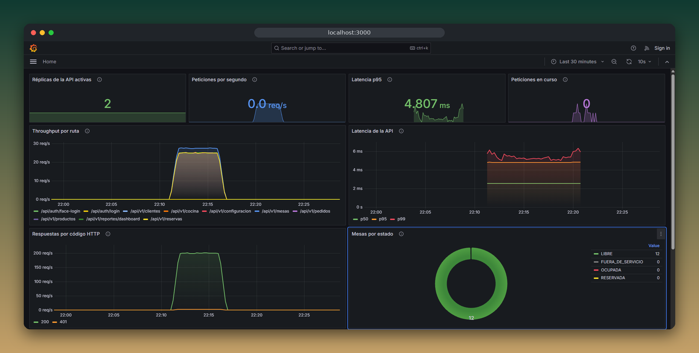
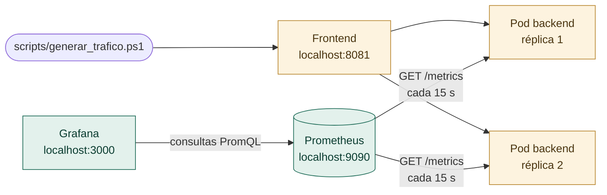
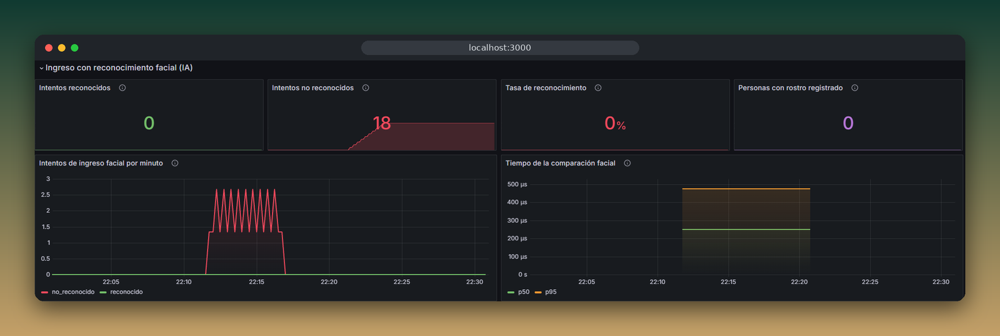

# Monitoreo con Prometheus y Grafana

Prometheus y Grafana corren dentro del mismo clúster que la aplicación, en el namespace `trattoria`. Prometheus lee las métricas de cada réplica del backend cada 15 segundos y Grafana las muestra en un dashboard que se carga solo al arrancar.





## Qué mide la API

Las métricas están en `backend/app/core/metricas.py` y se exponen en `GET /metrics`. Ese endpoint no pasa por el Nginx del frontend, así que solo se puede leer desde dentro del clúster.

| Métrica | Tipo | Qué cuenta |
|---|---|---|
| `trattoria_http_requests_total` | Counter | Peticiones atendidas, por método, ruta y código de respuesta |
| `trattoria_http_request_duration_seconds` | Histogram | Tiempo de respuesta por método y ruta |
| `trattoria_http_requests_en_curso` | Gauge | Peticiones que la réplica está atendiendo en ese momento |
| `trattoria_mesas` | Gauge | Mesas activas por estado, leídas de la vista `v_mesas_por_estado` |
| `trattoria_ingreso_facial_total` | Counter | Intentos de ingreso facial: `reconocido` o `no_reconocido` (HU-21) |
| `trattoria_ingreso_facial_comparacion_seconds` | Histogram | Tiempo de comparar el descriptor con los rostros registrados (HU-21) |
| `trattoria_personas_con_rostro` | Gauge | Usuarios con el rostro registrado (HU-21) |

La etiqueta `ruta` guarda la ruta como está declarada (`/api/v1/pedidos/{pedido_id}`) y no la URL real, para que cada pedido no cree una serie nueva en Prometheus. Las rutas que no existen se agrupan como `sin_ruta`.

## Qué hay en la carpeta

| Archivo | Qué crea |
|---|---|
| `01-prometheus.yaml` | Service headless `backend-metricas`, configuración de Prometheus, su Deployment y su Service en el puerto 9090 |
| `02-grafana.yaml` | Fuente de datos y proveedor de dashboards, el Deployment de Grafana y su Service en el puerto 3000 |
| `dashboard-trattoria.json` | El dashboard, guardado en el repositorio para poder cargarlo de nuevo |

## Desplegar

La aplicación ya tiene que estar corriendo en el clúster (ver [`k8s/README.md`](../README.md)). Los comandos se corren desde la raíz del repositorio.

**1. Prometheus**

```powershell
kubectl apply -f k8s/monitoreo/01-prometheus.yaml
```

**2. Contraseña del administrador de Grafana**

Se pide en la terminal y queda guardada solo en un Secret del clúster:

```powershell
$clave = Read-Host "Contraseña para el admin de Grafana"
kubectl create secret generic grafana-admin -n trattoria --from-literal=admin-password=$clave
```

**3. Dashboard**

El dashboard se carga desde el archivo del repositorio, igual que los scripts de la base:

```powershell
kubectl create configmap grafana-dashboard-trattoria -n trattoria --from-file=dashboard-trattoria.json=k8s/monitoreo/dashboard-trattoria.json
```

**4. Grafana**

```powershell
kubectl apply -f k8s/monitoreo/02-grafana.yaml
kubectl get pods,svc -n trattoria
```

**5. Revisar**

- Prometheus: <http://localhost:9090/targets>. En `trattoria-backend` deben aparecer las 2 réplicas en estado **UP**.
- Grafana: <http://localhost:3000>. Abre directo en el dashboard *Trattoria Bellavista - API*. Para verlo no hace falta iniciar sesión; para editarlo se entra con el usuario `admin` y la contraseña del paso 2.

## Generar tráfico

```powershell
powershell -ExecutionPolicy Bypass -File scripts\generar_trafico.ps1
```

El script pide la contraseña del usuario `admin` de la app, recorre 8 rutas de la API, hace algunas peticiones sin sesión (para que salgan respuestas 401) y reparte a lo largo de la prueba unos intentos de ingreso facial con descriptores al azar, que salen como no reconocidos. `-ExecutionPolicy Bypass` solo aplica a esa ejecución; no cambia la configuración de Windows.

Para ver las gráficas con una franja de tráfico más larga:

```powershell
powershell -ExecutionPolicy Bypass -File scripts\generar_trafico.ps1 -Rondas 7500 -IntentosFaciales 10
```

| Rondas | Duración aproximada | Peticiones |
|---|---|---|
| 200 (por defecto) | 10 segundos | unas 1.600 |
| 1500 | 1 minuto | unas 12.000 |
| 7500 | 5 minutos | unas 60.000 |

En nuestras pruebas, en un portátil con Docker Desktop, la API atendió unas 200 peticiones por segundo con una latencia p95 cercana a 5 ms.

> [!NOTE]
> Cada réplica acepta 10 intentos faciales fallidos cada 10 minutos (es una protección del ingreso facial). Si se piden más, los que sobran responden 429 y no alcanzan a compararse, así que no salen en el panel de la IA.

## El dashboard

| Panel | Consulta principal |
|---|---|
| Réplicas de la API activas | `count(up{job="trattoria-backend"} == 1)` |
| Peticiones por segundo / Throughput por ruta | `rate(trattoria_http_requests_total[1m])` |
| Latencia p95 / Latencia de la API | `histogram_quantile(0.95, ...duration_seconds_bucket...)` |
| Peticiones en curso | `sum(trattoria_http_requests_en_curso)` |
| Respuestas por código HTTP | `sum by (estado) (rate(trattoria_http_requests_total[1m]))` |
| Mesas por estado | `max by (estado) (trattoria_mesas)` |
| Ingreso con reconocimiento facial (IA) | intentos por resultado, tasa de reconocimiento, tiempo de la comparación y personas con rostro |

La sección de la IA, después de la misma prueba (los intentos son descriptores al azar, por eso todos salen como no reconocidos):



Los paneles de tráfico dejan por fuera `/health` y `/health/db`, porque esas rutas las llaman las probes de Kubernetes cada pocos segundos y taparían el tráfico real.

**Cambiar el dashboard.** Lo más cómodo es editarlo en Grafana como admin, exportarlo (*Share* > *Export* > *Save to file*), reemplazar `dashboard-trattoria.json` y recargarlo:

```powershell
kubectl delete configmap grafana-dashboard-trattoria -n trattoria
kubectl create configmap grafana-dashboard-trattoria -n trattoria --from-file=dashboard-trattoria.json=k8s/monitoreo/dashboard-trattoria.json
kubectl rollout restart deployment/grafana -n trattoria
```

> [!WARNING]
> No usar la forma `kubectl create ... --dry-run=client -o yaml | kubectl apply -f -` en Windows PowerShell: al pasar el texto por el `|`, PowerShell cambia las letras con tilde por `?` y los títulos quedan como "R??plicas". Nos pasó.

## Limitaciones

- Prometheus guarda las series en un volumen temporal (`emptyDir`): si su pod se reinicia, las gráficas empiezan de cero. Para la demostración alcanza; en producción iría un volumen persistente.
- Los contadores viven en la memoria de cada réplica, así que se reinician cuando se reinicia el pod. Las consultas con `rate()` y `increase()` ya tienen en cuenta esos reinicios.
- El panel de mesas consulta la base cada vez que Prometheus lee `/metrics` (cada 15 segundos por réplica). Es una consulta pequeña sobre una vista, pero si la base no responde, esa métrica simplemente no aparece en esa lectura.
- El histograma del tiempo de la comparación facial empieza en 0,5 ms. Con pocos rostros registrados todas las comparaciones caen en ese primer tramo, y Grafana muestra 250 µs (p50) y 475 µs (p95) porque interpola dentro de él; el tiempo real es menor. Si el número de personas crece, conviene revisar esos tramos.
- Los paneles muestran los últimos 30 minutos. Si no ha habido tráfico en ese rato, las gráficas salen vacías aunque Prometheus tenga los datos; basta con ampliar el rango de tiempo arriba a la derecha.
