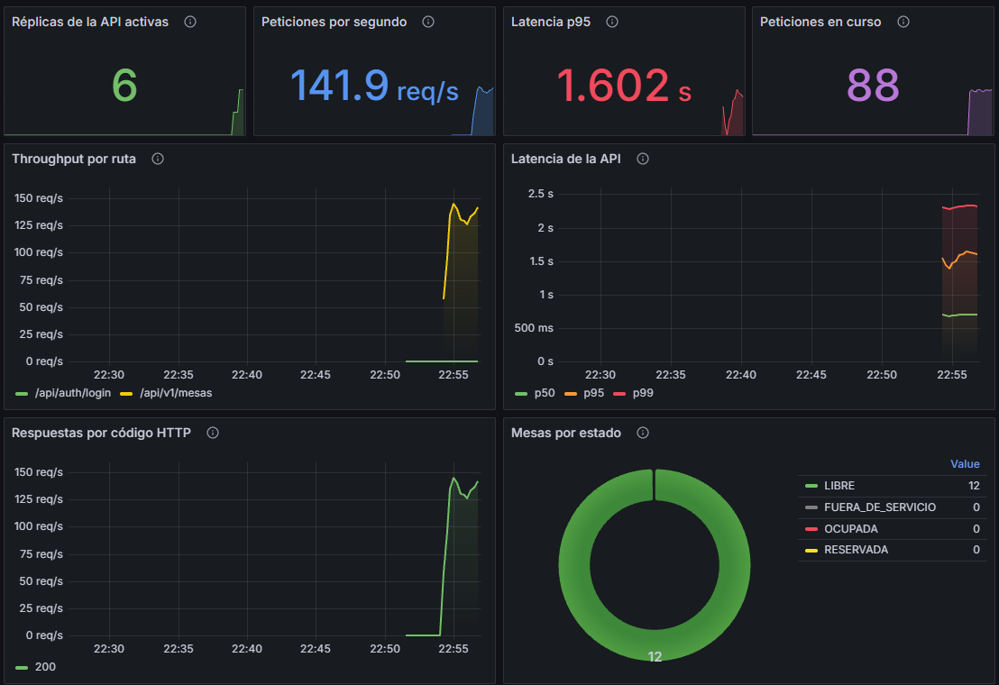
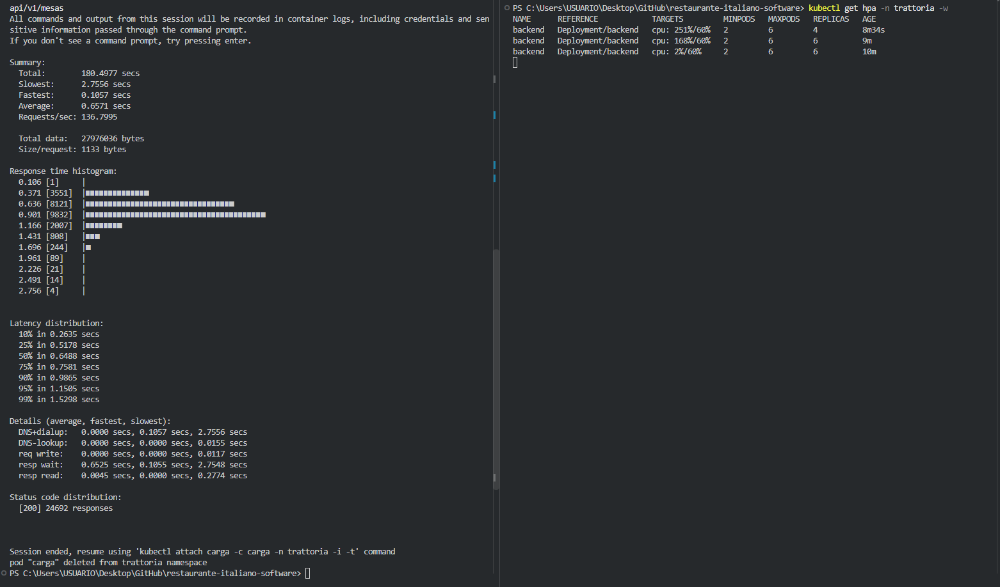
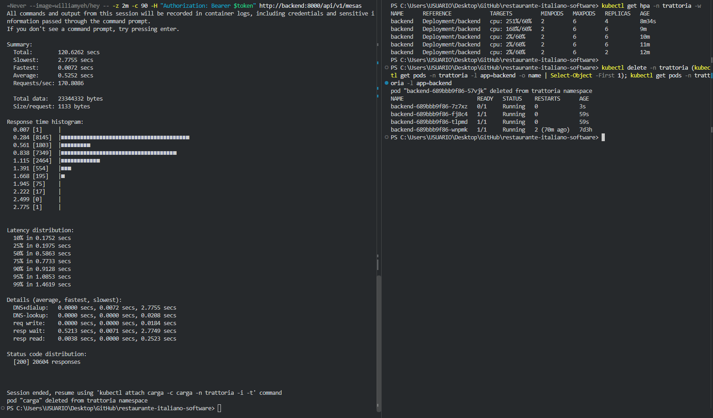
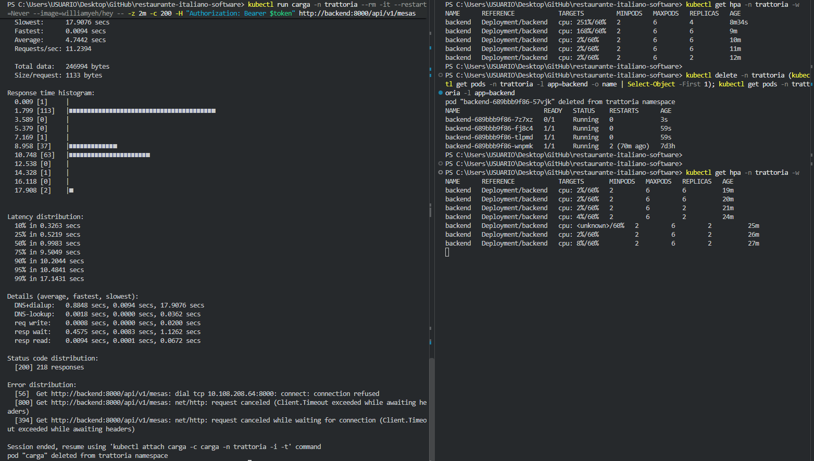
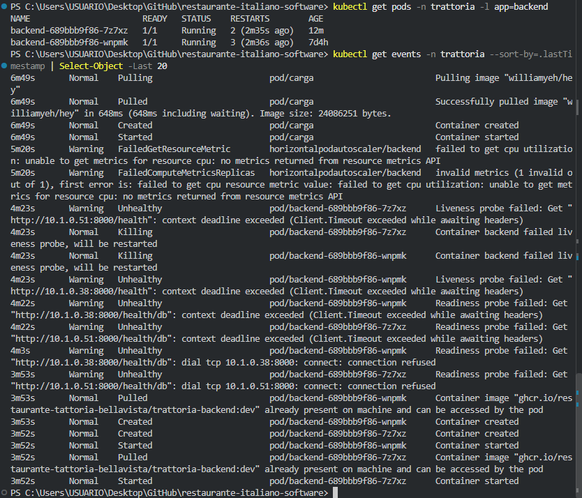

# Pruebas de carga en Kubernetes

Queríamos saber tres cosas de la API desplegada en el clúster: si el autoescalado agrega réplicas cuando mucha gente la usa al mismo tiempo, si Kubernetes reemplaza un pod que se cae sin que los usuarios lo noten y hasta dónde aguanta antes de fallar.

Las pruebas se hicieron el 26 de noviembre de 2026 en el Kubernetes de Docker Desktop (v1.36.1, un solo nodo), con la configuración que está en `k8s/`:

- La API arranca con 2 réplicas. Cada una pide 100m de CPU y tiene un límite de 500m.
- El autoescalado es el de `k8s/05-hpa.yaml`, que escribió Keiner: entre 2 y 6 réplicas, y sube cuando el uso promedio de CPU pasa del 60 % de lo que pide cada pod.
- La carga la generamos con [hey](https://github.com/rakyll/hey), corriendo dentro del clúster, contra `GET /api/v1/mesas` con un usuario que ya inició sesión.

## Resultados

| Prueba | Usuarios al tiempo | Duración | Respuestas correctas | Errores | Peticiones por segundo | p95 | Réplicas |
|---|---|---|---|---|---|---|---|
| 1. Solo carga | 90 | 3 min | 24.692 | 0 | 136,8 | 1,15 s | 2 → 6 → 2 |
| 2. Carga y borrar un pod | 90 | 2 min | 20.604 | 0 | 170,8 | 1,09 s | 2 → 4, un pod reemplazado |
| 3. Más carga | 200 | 2 min | 218 | 1.250 | 11,2 | 10,5 s | se quedó en 2 y los pods se reiniciaron |

El p95 es el tiempo en el que respondió el 95 % de las peticiones. Sin carga, la API responde en unos 5 ms.

### Prueba 1: 90 usuarios

Con 90 usuarios pidiendo al tiempo, cada réplica llegó al 251 % de la CPU que pide. El HPA subió a 4 réplicas, y un minuto después, con la CPU todavía en 168 %, llegó a 6, que es el máximo. Ninguna petición falló.

Cuando terminó la carga, la CPU bajó al 2 %, pero las 6 réplicas se quedaron unos 2 minutos más. Es a propósito: el HPA espera 2 minutos de calma antes de quitar réplicas, por si la carga vuelve. Después bajó solo a 2.





En Grafana la latencia p95 sale en 1,6 s y en hey en 1,15 s. La diferencia viene de cómo se calcula: Grafana la estima con los tramos del histograma de Prometheus (todo lo que está entre 1 y 2,5 s cae en el mismo tramo), mientras que hey mide cada petición.

### Prueba 2: borrar un pod en plena carga

Con la misma carga de 90 usuarios borramos una de las réplicas. Kubernetes creó otra de inmediato (`7z7xz`, con 3 segundos de vida en la captura). La réplica nueva aparece como `0/1` en READY: ya está corriendo, pero Kubernetes no le manda tráfico hasta que la readiness probe confirma que la API y la base responden. Por eso ninguna de las 20.604 peticiones falló.

En la misma captura se ven `fj8c4` y `tlpmd`, que son las réplicas que agregó el HPA durante esta prueba.



### Prueba 3: 200 usuarios

Con 200 usuarios la API no aguantó. Solo 218 peticiones respondieron bien. El resto falló porque no hubo respuesta en 20 segundos o porque el Service no tenía ningún pod disponible (`connection refused`).

Lo raro fue que la CPU casi no subió (entre 4 % y 8 %), así que el HPA nunca agregó réplicas.



Los eventos del clúster muestran qué pasó. La liveness probe (`/health`) no contestó a tiempo en ninguno de los dos pods, así que Kubernetes los reinició casi en el mismo segundo. Antes ya los había sacado del Service porque la readiness probe (`/health/db`) también fallaba. Cuando bajó la carga, los dos pods volvieron a quedar bien.



Lo anterior está en las capturas. Por qué el `/health` no contestó no lo medimos, pero esta es la explicación que cuadra con el código:

- Cada réplica abre como máximo 15 conexiones a PostgreSQL. Son los valores por defecto de SQLAlchemy, porque `backend/app/db/session.py` no los cambia.
- Con 200 usuarios, casi todas las peticiones se quedan esperando una conexión libre. Esperar no gasta CPU, y por eso el HPA no ve nada raro.
- `/health` es una función normal (`def`), así que necesita uno de los hilos de FastAPI para responder, y esos hilos están ocupados con las peticiones que esperan. Las probes solo esperan 1 segundo, que es el valor por defecto, y fallan.

O sea, con esta configuración el límite no lo pone la CPU sino las conexiones a la base, y un HPA que solo mira la CPU no se entera.

## Qué se podría mejorar

- Cambiar `/health` a `async def` para que responda aunque los hilos estén ocupados. Así Kubernetes no reinicia pods que solo están muy cargados.
- Darles más tiempo a las probes con `timeoutSeconds` en `k8s/03-backend.yaml`.
- Ajustar `pool_size` y `max_overflow` en `session.py`, sin pasarse del máximo de conexiones de PostgreSQL (100 por defecto; con 6 réplicas de 15 ya son 90), o poner PgBouncer entre la API y la base.
- Escalar también según las peticiones en curso, que ya están en Prometheus (`trattoria_http_requests_en_curso`) y no solo según la CPU.

## Cómo repetir las pruebas

Todo se corre en PowerShell, con el clúster arriba como explica el [README de Kubernetes](README.md).

**1. Instalar metrics-server.** El HPA lo necesita para medir la CPU y Docker Desktop no lo trae. El ajuste `--kubelet-insecure-tls` se pasa por un archivo porque PowerShell daña las comillas si el JSON va directo en el comando:

```powershell
kubectl apply -f https://github.com/kubernetes-sigs/metrics-server/releases/latest/download/components.yaml
Set-Content -Path "$env:TEMP\parche-metrics.json" -Value '[{"op":"add","path":"/spec/template/spec/containers/0/args/-","value":"--kubelet-insecure-tls"}]'
kubectl patch deployment metrics-server -n kube-system --type=json --patch-file "$env:TEMP\parche-metrics.json"
kubectl top pods -n trattoria   # al minuto debe mostrar la CPU de cada pod
```

**2. Aplicar el HPA:**

```powershell
kubectl apply -f k8s/05-hpa.yaml
kubectl get hpa -n trattoria   # TARGETS debe mostrar algo como cpu: 2%/60%
```

Si `05-hpa.yaml` todavía no está en tu rama, se puede aplicar directo desde la rama de Keiner:

```powershell
kubectl apply -f https://raw.githubusercontent.com/Restaurante-Tattoria-Bellavista/restaurante-italiano-software/feature/pedido-por-voz/k8s/05-hpa.yaml
```

**3. Sacar un token.** Las rutas de la API están protegidas. Esto inicia sesión con el admin de la app sin mostrar la contraseña ni el token:

```powershell
$segura = Read-Host "Contraseña del admin de la app" -AsSecureString
$clave = [Runtime.InteropServices.Marshal]::PtrToStringAuto([Runtime.InteropServices.Marshal]::SecureStringToBSTR($segura)); $token = (Invoke-RestMethod -Method Post -Uri "http://localhost:8081/api/auth/login" -ContentType "application/json" -Body (@{ username = "admin"; password = $clave } | ConvertTo-Json)).token; $clave = $null; Write-Host "Token listo: $($token.Length) caracteres"
```

**4. Lanzar la carga.** En otra terminal, deja corriendo `kubectl get hpa -n trattoria -w` para ver cómo cambian las réplicas. `-c` es la cantidad de usuarios al tiempo y `-z` la duración. El pod `carga` se borra solo al terminar:

```powershell
kubectl run carga -n trattoria --rm -it --restart=Never --image=williamyeh/hey -- -z 3m -c 90 -H "Authorization: Bearer $token" http://backend:8000/api/v1/mesas
```

Usamos hey en vez de `scripts/generar_trafico.ps1` porque el script manda una petición a la vez, como un solo usuario muy rápido. Para simular mucha gente al mismo tiempo hace falta mandar las peticiones en paralelo.

**5. Borrar un pod durante la carga** (prueba 2):

```powershell
kubectl delete -n trattoria (kubectl get pods -n trattoria -l app=backend -o name | Select-Object -First 1); kubectl get pods -n trattoria -l app=backend
```

**6. Ver qué pasó** si algo falla:

```powershell
kubectl get pods -n trattoria -l app=backend   # columna RESTARTS
kubectl get events -n trattoria --sort-by=.lastTimestamp | Select-Object -Last 20
```
